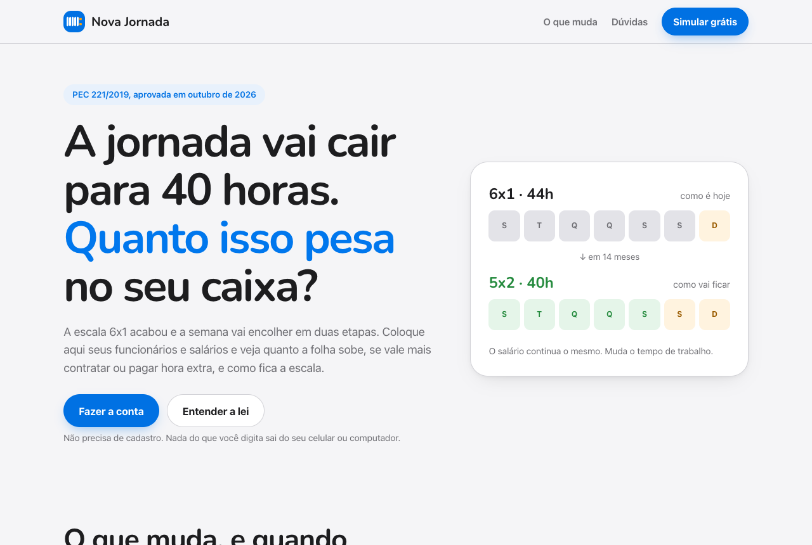
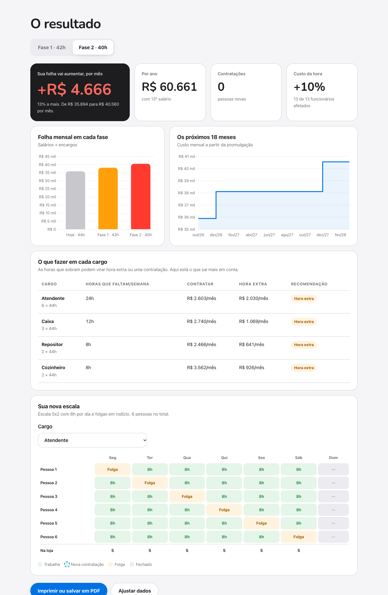

<div align="center">



# Nova Jornada

**Quanto o fim da escala 6x1 vai custar para o seu negócio?**

Um simulador gratuito para pequenos empreendedores entenderem, em poucos minutos, o impacto da redução da jornada de 44 para 40 horas na folha de pagamento.

[**Abrir o simulador**](https://jornada.danyalgil.com) · [Como funciona a conta](#como-a-conta-é-feita) · [Rodar no seu computador](#rodar-no-seu-computador)

</div>

---

## Por que isso existe

Em 14 de outubro de 2026, o Senado aprovou a **PEC 221/2019** por 75 votos a 1. O texto acaba com a escala 6x1 e reduz a jornada máxima sem cortar salário:

| Quando | Jornada máxima | O que muda |
|---|---|---|
| Hoje | 44h por semana | Até 6 dias de trabalho e 1 folga |
| 60 dias após a promulgação | **42h** por semana | Escala máxima 5x2, com 2 dias de descanso remunerado |
| 12 meses depois | **40h** por semana | Até 8 horas por dia |

O salário é o mesmo e as horas diminuem, então o custo de cada hora sobe cerca de 10%. Para uma empresa grande isso é uma linha na planilha do RH. Para a padaria do bairro, pode ser a diferença entre contratar mais uma pessoa ou não.

O Nova Jornada responde três perguntas:

1. **Quanto a minha folha vai subir?** Por mês, por ano e em cada fase da transição.
2. **Contrato alguém ou pago hora extra?** A comparação é feita cargo por cargo.
3. **Como fica a escala?** Uma escala 5x2 com folgas em rodízio, montada para os dias em que você abre.

<div align="center">

</div>

## Como usar

1. Digite seus cargos (quantas pessoas, salário e horas por semana) ou **envie uma planilha do Excel**. Dá para baixar um modelo pronto no próprio site.
2. Marque os dias em que o negócio abre e o regime de impostos.
3. Veja o resultado, troque entre a Fase 1 (42h) e a Fase 2 (40h) e, se quiser, imprima ou salve em PDF para levar ao contador.

Tudo roda no navegador. **Nenhum dado é enviado para servidor nenhum.**


## Como a conta é feita

Para cada cargo e cada teto de horas:

- **Horas que faltam por semana** = pessoas × (horas atuais − novo teto)
- **Contratar** = arredondar para cima (horas que faltam ÷ novo teto) × salário × (1 + encargos)
- **Hora extra** = horas que faltam × 4,33 semanas × (salário ÷ (teto × 5)) × 1,5 × (1 + encargos)
- A recomendação é a opção mais barata.

Encargos padrão: **37%** no Simples Nacional e **70%** no Lucro Presumido ou Real. Você pode informar o seu percentual.

A estimativa serve para planejar. Ela não considera adicionais, comissões, convenções coletivas, reflexos da hora extra em férias e 13º, nem as regras de transição para MEI, ME e EPP, que ainda serão definidas em lei complementar.

<br clear="right">

## Rodar no seu computador

Não precisa instalar nada. São três arquivos estáticos: `index.html`, `app.js` e `calc.js`.

```bash
git clone https://github.com/ricdanyalgil/nova-jornada.git
cd nova-jornada
python3 -m http.server 4173
```

Depois abra `http://localhost:4173`.

Para conferir os cálculos:

```bash
node calc.test.mjs
```

## Fontes

- [Agência Brasil: Senado aprova fim da escala 6x1](https://agenciabrasil.ebc.com.br/politica/noticia/2026-10/senado-aprova-fim-da-escala-6x1-e-reducao-da-jornada-de-trabalho)
- [Agência Senado: Senado aprova fim da escala 6x1](https://www12.senado.leg.br/noticias/materias/2026/10/14/senado-aprova-fim-da-escala-6x1-1)
- [Agência Brasil: Câmara aprova a PEC em dois turnos (maio de 2026)](https://agenciabrasil.ebc.com.br/politica/noticia/2026-05/camara-aprova-em-dois-turnos-pec-pelo-fim-da-escala-6x1)
- [Gazeta do Povo: impacto nos pequenos negócios](https://www.gazetadopovo.com.br/economia/fim-da-escala-6x1-ameaca-elevar-custos-de-pequenos-negocios-em-125percent/)

## Contribuir

Achou um erro na conta ou tem uma regra do seu setor que deveria entrar? Abra uma issue ou mande um pull request.

## Autor

Desenvolvido por **Ricardo Danyalgil Júnior**.

Licença MIT. Use, copie e adapte à vontade.

> Este projeto não substitui a orientação de um contador ou advogado trabalhista.
